# Taller de tolerancia a fallos en HDFS y YARN

**Estudiante:** _[tu nombre]_  
**Curso / Profesor:** _[curso]_ · _[profesor]_  
**Fecha de ejecución:** 14–15 de noviembre de 2026

---

## 1. Entorno

Clúster Hadoop 3.4.1 desplegado con Docker Compose:

| Servicio | Contenedor | Rol |
|---|---|---|
| namenode | `hdfs-failure-lab-namenode-1` | Metadatos de HDFS |
| resourcemanager | `hdfs-failure-lab-resourcemanager-1` | Planificación de YARN |
| datanode1, datanode2, datanode3 | `hdfs-failure-lab-datanodeN-1` | DataNode + NodeManager |
| historyserver | `hdfs-failure-lab-historyserver-1` | Logs de jobs terminados |
| client | `hdfs-failure-lab-client-1` | Ejecución de comandos y jobs |

- **Dataset:** `/reviews/input/reviews_filmaffinity.csv` (11 545 583 B, 12 bloques de ~1 MB).
- **Jobs MapReduce:** `01-wordcount` y `02-promedio-genero`.
- **Factor de replicación por defecto:** 3.

---

## 2. Estado base del clúster (captura preliminar)

Antes de cada experimento se verificó que el clúster estuviera sano.

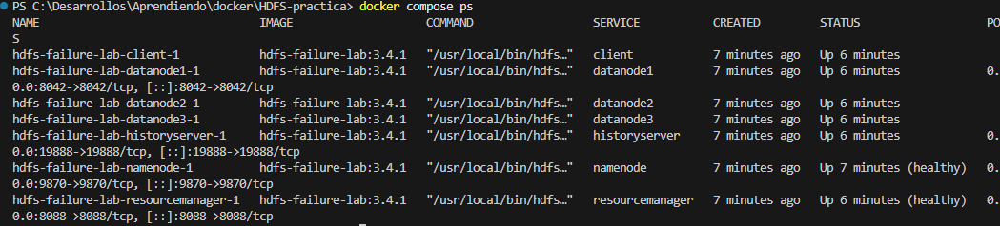

*Todos los contenedores están arriba; `namenode` y `resourcemanager` aparecen como* healthy.

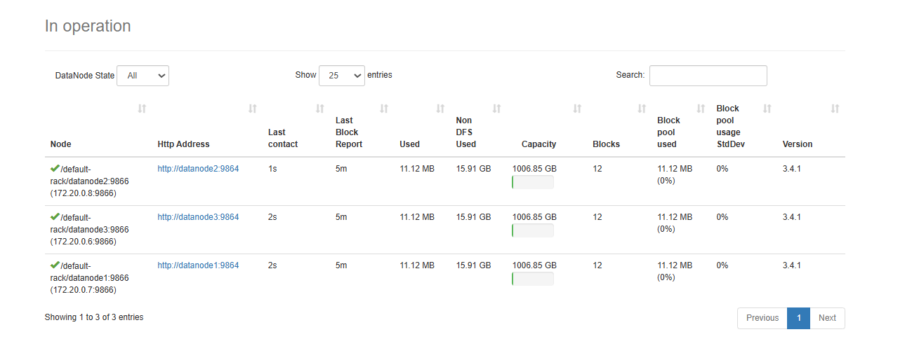

*Los 3 DataNodes están* In Service*, con* Last contact *de 1–2 s y 12 bloques cada uno.*

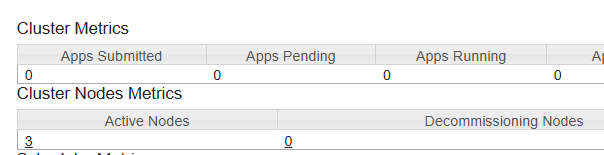

*YARN reporta 3 nodos activos (*Active Nodes: 3*) y ninguna aplicación en ejecución.*

---

## 3. Experimento A: apagar un DataNode

**Hipótesis.** Si cae un DataNode, el NameNode lo marca como muerto, re-replica los bloques que quedaron con menos copias y el archivo sigue leyéndose sin interrupción.

**Preparación.** Con 3 nodos y replicación 3 no hay a dónde re-replicar, así que se bajó la replicación del archivo a 2:

```bash
hdfs dfs -setrep -w 2 /reviews/input/reviews_filmaffinity.csv
hdfs fsck /reviews/input -files -blocks -locations
```

**Fallo provocado:**

```bash
docker compose stop datanode3
```

### Antes del fallo

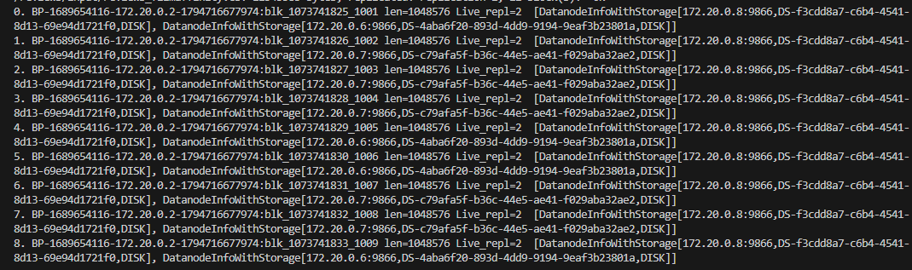

*Los bloques tienen 2 réplicas* (`Live_repl=2`)*, repartidas entre los DataNodes (172.20.0.6 = datanode3, 172.20.0.7 = datanode1, 172.20.0.8 = datanode2).*

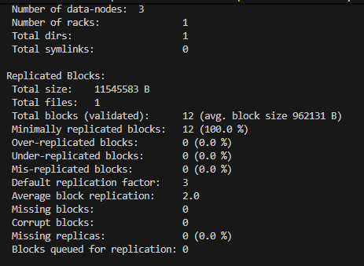

*El resumen muestra 3 DataNodes, 12 bloques,* Under-replicated: 0 *y* Average block replication: 2.0.*

### Después del fallo

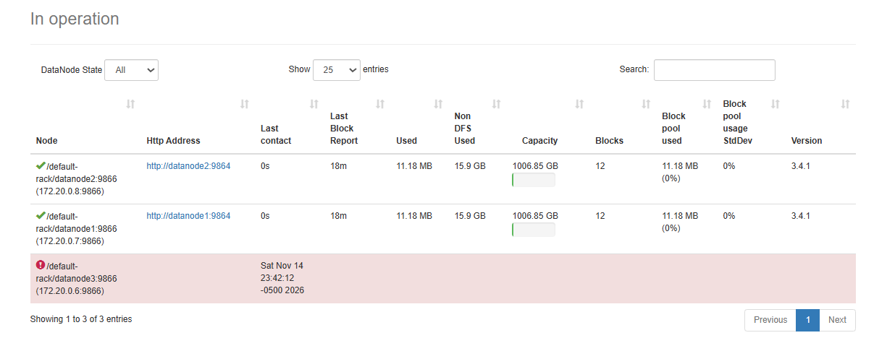

*datanode3 (172.20.0.6) aparece en rojo como caído (*Dead*). Su último contacto fue el 14 de noviembre a las 23:42:12. Los otros dos siguen con* Last contact *de 0 s.*

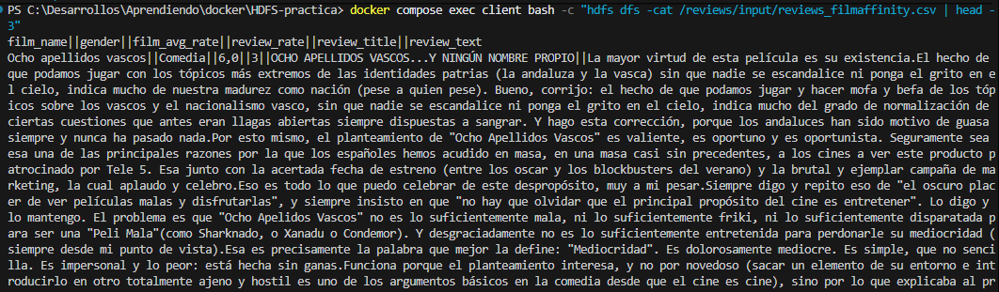

*Con el nodo caído, `hdfs dfs -cat ... | head -3` devuelve el encabezado y las primeras filas del CSV: **la información sigue accesible**.*

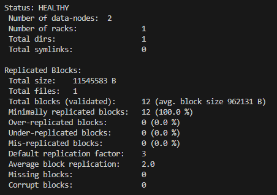

*El `fsck` reporta* Status: HEALTHY *con 2 DataNodes,* Under-replicated: 0*,* Missing blocks: 0 *y* Corrupt blocks: 0*; los 12 bloques mantienen 2 réplicas.*

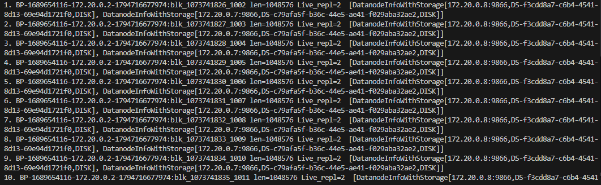

*Ahora todas las réplicas se ubican **solo** en 172.20.0.7 (datanode1) y 172.20.0.8 (datanode2).*

### Análisis

- El NameNode detectó la caída y marcó a datanode3 como *Dead*.
- Los bloques que estaban en datanode3 se copiaron a los nodos vivos, lo que se ve al comparar A1 con A6b: antes había réplicas en 172.20.0.6 y después ya no.
- No hubo pérdida de datos ni interrupción de lectura.

---

## 4. Experimento B: detener un NodeManager durante un job

**Hipótesis.** Si cae solo el NodeManager de un nodo (el DataNode sigue vivo), YARN reprograma las tareas afectadas en otros nodos y el job termina correctamente.

**Procedimiento.** Se lanzó el job y, mientras corría, se detuvo el NodeManager de datanode2:

```bash
# T1
docker compose exec client bash /workspace/jobs/run.sh wordcount
# T2
docker compose exec datanode2 yarn --daemon stop nodemanager
```

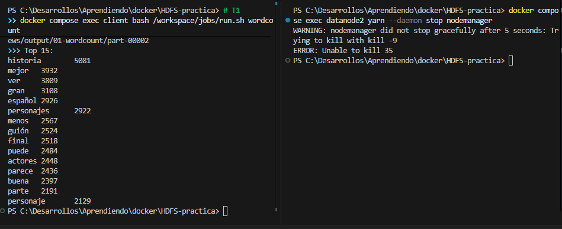

*A la derecha (T2) se ejecuta la parada del NodeManager. Hadoop avisa de que no se detuvo de forma ordenada tras 5 s y recurre a `kill -9`. A la izquierda (T1) el job termina y se imprime el Top 15.*

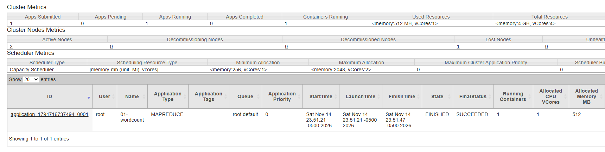

*El ResourceManager muestra 2 nodos activos y 1 nodo perdido (*Lost Nodes: 1*), mientras la aplicación `application_1794716737494_0001` (`01-wordcount`) figura como* FINISHED / SUCCEEDED*.*

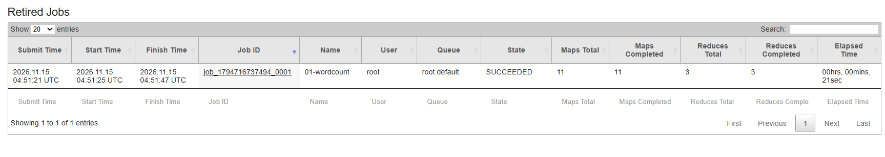

*El histórico confirma `job_1794716737494_0001`: estado* SUCCEEDED*, 11 maps completados de 11 y 3 reduces completados de 3, en 21 s.*

### Resultado idéntico

El Top 15 obtenido es el mismo que en una ejecución sin fallos (`historia 5081`, `mejor 3932`, `ver 3809`, `gran 3108`, `español 2926`, …).

### Análisis

- Perder el NodeManager de datanode2 no hizo fallar el job.
- YARN marcó el nodo como *Lost* y el job terminó con `SUCCEEDED` y con el mismo resultado.
- Como el DataNode de datanode2 seguía vivo, **HDFS no se vio afectado**: solo se perdió capacidad de cómputo.

---

## 5. Experimento C: matar una máquina entera durante la fase Map

**Hipótesis.** Si cae un nodo completo (DataNode y NodeManager a la vez) en pleno Map, las lecturas se redirigen a otra réplica, las tareas se reintentan y el job termina con el resultado correcto.

**Procedimiento.** Se ejecutó el job `promedio` (`02-promedio-genero`) y se mató datanode1 durante el Map:

```bash
# T1
docker compose exec client bash /workspace/jobs/run.sh promedio
# T2
docker compose kill datanode1
```

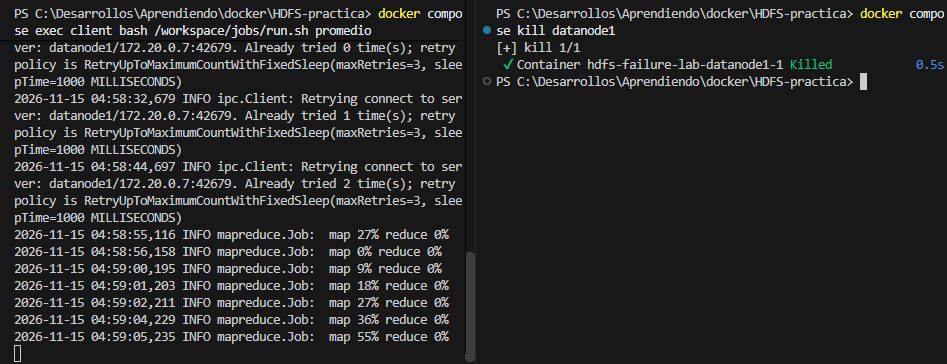

*Tras `docker compose kill datanode1` (derecha), el cliente (izquierda) registra* Retrying connect to server: datanode1/172.20.0.7 *(intentos 0, 1 y 2, política* RetryUpToMaximumCountWithFixedSleep*, 3 reintentos, 1 s). El progreso del Map **retrocede** (27 % → 0 %) y luego se recupera (9 % → 18 % → 27 % → 36 % → 55 %): las tareas del nodo caído se reejecutan.*

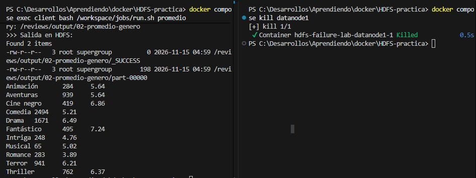

*El job termina y escribe el resultado en `/reviews/output/02-promedio-genero` (`_SUCCESS` y `part-00000`), con la media de nota por género (p. ej. Fantástico 7.24, Cine negro 6.86, Drama 6.49).*

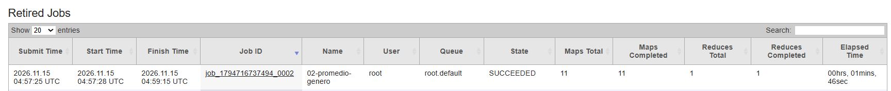

*`job_1794716737494_0002` aparece como* SUCCEEDED *con 11 maps y 1 reduce completados, en 1 min 46 s (frente a los 21 s del job B, que no tuvo fallo de datos).*

### Análisis

- Aunque se perdieron a la vez un DataNode y un NodeManager, el job terminó correctamente: HDFS sirvió los bloques desde las réplicas restantes y YARN reprogramó el trabajo.
- El costo del fallo se ve en el tiempo: la ejecución tardó bastante más por los reintentos y la re-ejecución de maps.
- Las réplicas explican que no hubo pérdida de datos: con replicación 3, cada bloque seguía existiendo en los otros dos nodos.

---

## 6. Experimento D: reiniciar el NameNode durante escrituras

**Hipótesis.** Perder un DataNode no detiene HDFS, pero perder el NameNode sí: es el punto único de fallo. Al volver, el NameNode arranca en *safe mode* hasta que los DataNodes le reportan sus bloques.

**Procedimiento.** Se lanzó una tanda de 20 escrituras seguidas y se reinició el NameNode a mitad:

```bash
# T1
for i in $(seq 1 20); do hdfs dfs -put -f /workspace/datasets/reviews_filmaffinity.csv /tmp/copia$i.csv && echo "ok $i"; done
# T2
docker compose restart namenode
```

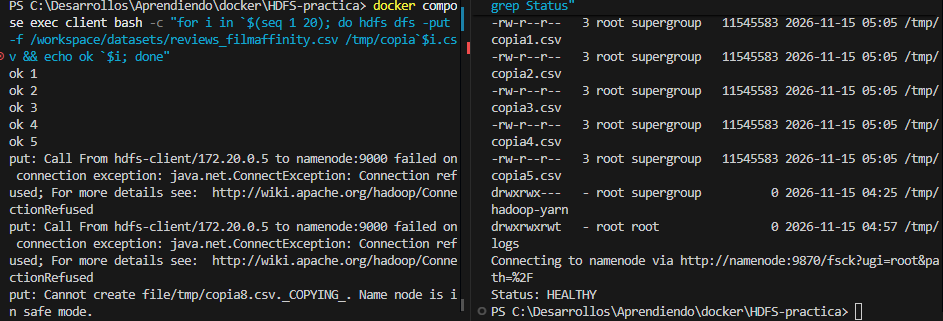

*A la izquierda (escrituras): se completan las escrituras `ok 1` a `ok 5`. Luego aparece `ConnectException: Connection refused` contra `namenode:9000` (el NameNode no está) y, después, `Cannot create file /tmp/copia8.csv._COPYING_. Name node is in safe mode`.*

*A la derecha (verificación): tras el reinicio, `/tmp` contiene `copia1.csv` … `copia5.csv` (11 545 583 B cada una, replicación 3) y el `fsck` final reporta* Status: HEALTHY*.*

### Análisis

- Mientras el NameNode estuvo caído, **ninguna escritura pudo completarse**, aunque los tres DataNodes seguían vivos: sin NameNode no hay metadatos ni HDFS operativo.
- Al volver, el NameNode entró en *safe mode* y rechazó escrituras hasta recibir los reportes de bloques.
- Las escrituras que ya habían terminado (1–5) se conservaron y el sistema quedó `HEALTHY`, sin datos perdidos ni corruptos. Las que cayeron en la ventana del reinicio fallaron, lo cual es el comportamiento esperado.

---

## 7. Conclusiones

| Experimento | Componente que cae | Efecto observado | ¿Se pierden datos? |
|---|---|---|---|
| **A** | 1 DataNode | Marcado *Dead*; bloques re-replicados a los nodos vivos; lectura sin interrupción | No |
| **B** | 1 NodeManager | Nodo *Lost* en YARN; job termina `SUCCEEDED` con el mismo resultado | No |
| **C** | Nodo completo (DataNode + NodeManager) | Reintentos de conexión y de tareas; job `SUCCEEDED` más lento | No |
| **D** | NameNode | HDFS inoperante; *safe mode* al volver; escrituras en ventana fallan | No |

1. **La replicación protege los datos.** En A y C, tener cada bloque en varios nodos permitió sobrevivir a la pérdida de un DataNode sin perder nada.
2. **YARN reintenta el cómputo.** En B y C, las tareas de los nodos caídos se reprogramaron en otros y el resultado final fue idéntico.
3. **Los fallos tienen un costo.** El job de C tardó 1 min 46 s frente a 21 s del B; la tolerancia a fallos se paga en tiempo.
4. **El NameNode es un punto único de fallo.** En D, perder un solo componente de metadatos detuvo por completo las escrituras, algo que no ocurrió con ningún DataNode. En producción se mitiga con NameNode en alta disponibilidad (HA).
