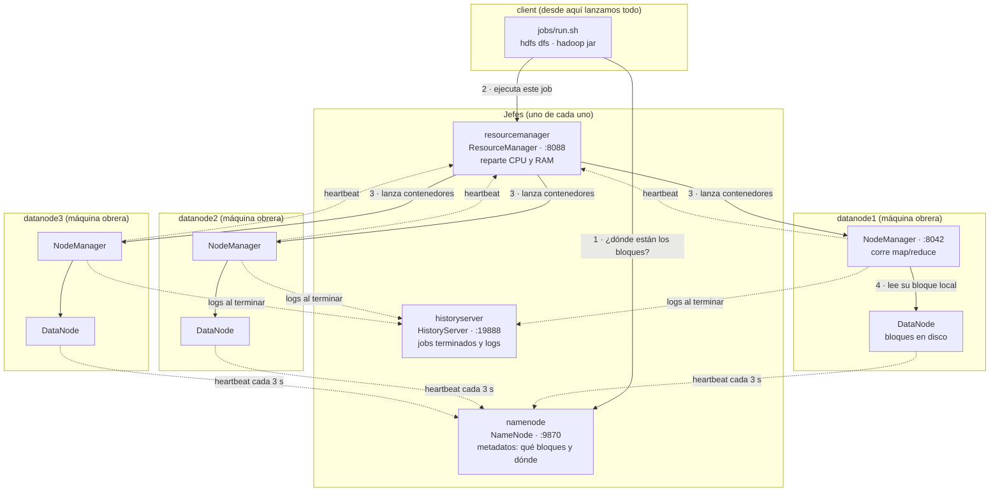
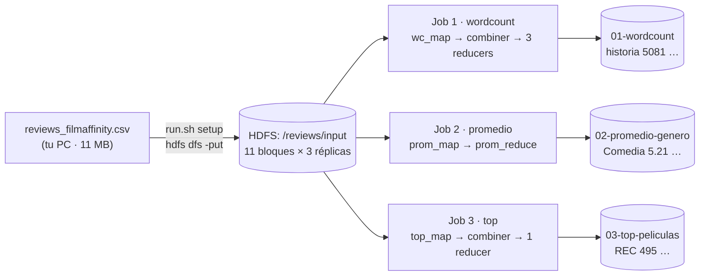
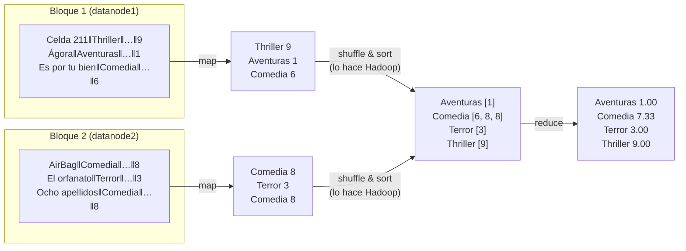
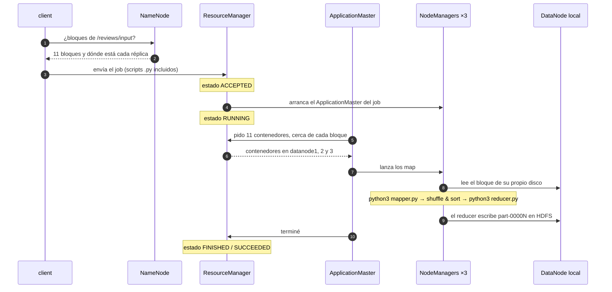
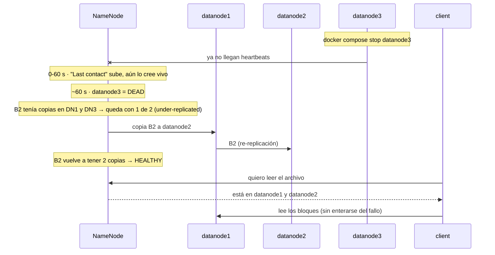
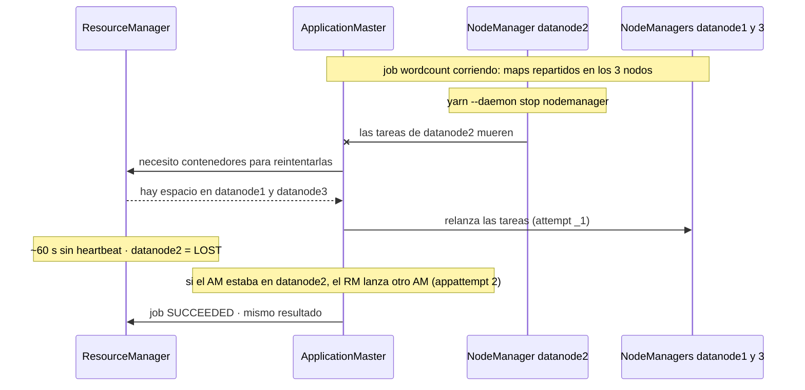
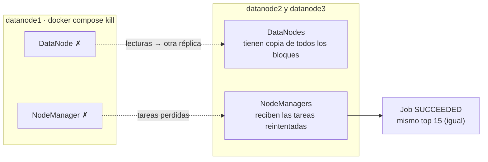
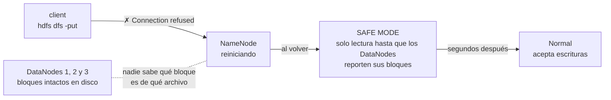

# Sustentación — HDFS, YARN y MapReduce con Docker

Guion completo para la demostración: qué mostrar, en qué orden, qué comandos ejecutar y qué resultado esperar en cada paso.

> **Convención:** todos los comandos se ejecutan desde la raíz del repositorio. Las tuberías (`|`) van **dentro** del contenedor (`bash -c "..."`) para que funcionen igual en PowerShell, CMD, Git Bash, Linux o macOS.

---

## Índice

0. [Antes de la sustentación](#0-antes-de-la-sustentación) · incluye *Cómo leer los comandos* y *Un job sin `run.sh`*
1. [Arquitectura](#1-arquitectura) · diagramas del clúster, de los jobs y de la vida de un job
2. [Punto 1 — Clúster HDFS + YARN](#2-punto-1--clúster-hdfs--yarn)
3. [Punto 2 — Jobs MapReduce](#3-punto-2--jobs-mapreduce)
4. [Punto 3 — Verificación de la ejecución](#4-punto-3--verificación-de-la-ejecución)
5. [Punto 4 — Tolerancia a fallos](#5-punto-4--tolerancia-a-fallos)
6. [Preguntas probables del profesor](#6-preguntas-probables-del-profesor)
7. [Problemas que encontramos y cómo se resolvieron](#7-problemas-que-encontramos-y-cómo-se-resolvieron)
8. [Solución de problemas en vivo](#8-solución-de-problemas-en-vivo)
9. [Checklist final](#9-checklist-final)

---

## 0. Antes de la sustentación

Hacer esto **antes** de la clase (la primera construcción descarga Hadoop, ~900 MB, y tarda varios minutos).

```bash
git pull
docker compose build
docker compose up -d
docker compose ps
```

**Requisitos:** Docker Desktop abierto y con **al menos 6 GB de RAM** asignados (Settings → Resources).

**Esperado en `docker compose ps`:** `namenode` y `resourcemanager` en `healthy`; `datanode1..3`, `historyserver` y `client` en `running`.

Opcional — dejar el input ya cargado para no perder tiempo:

```bash
docker compose exec client bash /workspace/jobs/run.sh setup
```

### Empezar desde cero (si el clúster quedó en mal estado)

```bash
docker compose down -v      # -v borra los volúmenes: se pierde TODO lo que hay en HDFS
docker compose up -d
docker compose exec client bash /workspace/jobs/run.sh setup
```

### Pestañas para tener abiertas

| URL | Servicio |
|---|---|
| http://localhost:9870 | NameNode (HDFS) |
| http://localhost:8088 | ResourceManager (YARN) |
| http://localhost:19888 | HistoryServer (jobs terminados) |
| http://localhost:8042 | NodeManager de datanode1 |

> Los enlaces internos de las UIs apuntan a nombres como `datanode2:8042` o `historyserver:19888`. El navegador no los conoce: basta con cambiar el nombre por `localhost` (cuando el puerto está publicado) o ignorarlos.

### Cómo leer los comandos

Casi todos los comandos tienen la misma forma:

```
docker compose exec  client   hdfs dfs -ls /reviews
└──────┬──────────┘  └──┬──┘  └───────┬────────┘
 "ejecuta dentro de"  contenedor   el comando de Hadoop
```

**Atajo para la demo:** abrir una terminal *dentro* del cliente una sola vez y escribir solo la parte de Hadoop:

```bash
docker compose exec client bash
# ahora estamos dentro del contenedor:
hdfs dfs -ls /reviews
bash /workspace/jobs/run.sh promedio
exit
```

| Comando | Qué hace, en una frase |
|---|---|
| `docker compose up -d` / `ps` / `logs <servicio>` | Levanta el clúster / muestra los contenedores / muestra el log de uno |
| `docker compose stop` / `start` / `kill` / `restart <servicio>` | Apaga / enciende / mata de golpe / reinicia un contenedor (para los fallos) |
| `hdfs dfs -put <local> <hdfs>` | Sube un archivo de tu disco a HDFS |
| `hdfs dfs -ls <ruta>` / `-cat <archivo>` | Lista / muestra archivos de HDFS (igual que `ls` y `cat` en Linux) |
| `hdfs dfs -rm -r <ruta>` | Borra en HDFS |
| `hdfs dfs -setrep -w <n> <archivo>` | Cambia cuántas copias tiene el archivo y espera a que se apliquen |
| `hdfs dfsadmin -report` | Estado de HDFS: DataNodes vivos y muertos, espacio |
| `hdfs fsck <ruta> -files -blocks -locations` | Revisa la salud de los archivos: bloques, réplicas y en qué nodo está cada una |
| `hdfs dfsadmin -safemode get` | ¿El NameNode está en modo solo lectura? |
| `yarn node -list -all` | NodeManagers registrados y su estado (RUNNING, LOST…) |
| `yarn application -list -appStates ALL` | Jobs y su estado (RUNNING, SUCCEEDED, FAILED…) |
| `yarn logs -applicationId <id>` | Logs de todas las tareas de un job (incluye los errores de Python) |
| `yarn --daemon stop` / `start nodemanager` | Apaga / enciende solo el NodeManager de una máquina |
| `hadoop jar hadoop-streaming.jar …` | Lanza un job MapReduce con scripts (ver abajo) |

### Un job sin `run.sh`

`run.sh` solo evita escribir rutas largas. Lo que ejecuta por dentro, por ejemplo para el promedio, es **un único comando**:

```bash
hadoop jar /opt/hadoop/share/hadoop/tools/lib/hadoop-streaming-3.4.1.jar \
  -files /workspace/jobs/texto.py,/workspace/jobs/prom_map.py,/workspace/jobs/prom_reduce.py \
  -cmdenv PYTHONPATH=. \
  -mapper  "python3 prom_map.py" \
  -reducer "python3 prom_reduce.py" \
  -input   /reviews/input \
  -output  /reviews/output/02-promedio-genero
```

| Línea | Significado |
|---|---|
| `hadoop jar …streaming.jar` | “Quiero un job MapReduce cuyo map y reduce son programas cualquiera (aquí, Python)” |
| `-files …` | Copia estos scripts a cada nodo donde corra una tarea |
| `-cmdenv PYTHONPATH=.` | Para que `import texto` encuentre `texto.py` en el directorio de la tarea |
| `-mapper` / `-reducer` | Qué programa ejecutar en cada fase |
| `-input` / `-output` | Carpeta de HDFS que se lee / carpeta nueva donde se escribe el resultado (no debe existir) |

Opcionales que usan otros jobs: `-combiner` (wordcount), `-numReduceTasks N` (cuántos reducers). Antes de lanzar, `run.sh` borra la salida anterior, porque Hadoop se niega a sobrescribirla.

---

## 1. Arquitectura

Hadoop no es un solo “manejador”: son **dos sistemas**, cada uno con su jefe, y MapReduce corre encima de ambos.

| Capa | Jefe | Obrero (uno por máquina) | Le importa |
|---|---|---|---|
| **HDFS** (almacenamiento) | NameNode | DataNode | Dónde están los datos |
| **YARN** (recursos) | ResourceManager | NodeManager | Cuánta CPU/RAM hay libre y quién la usa |
| **MapReduce** (programa) | ApplicationMaster (uno por job) | Contenedores map / reduce | El cálculo |

### 1.1 Los contenedores y cómo se hablan



Cómo leerlo:

- **HDFS:** NameNode + DataNodes guardan los datos.
- **YARN:** ResourceManager + NodeManagers ejecutan el cómputo.
- **Cada máquina obrera tiene las dos cosas**, por eso el mapper lee el bloque **de su propio disco** (paso 4).
- Las líneas punteadas son los **heartbeats**: así los jefes saben quién sigue vivo. Cuando dejan de llegar, empieza la tolerancia a fallos (sección 5).

### 1.2 Los jobs de este proyecto



Los tres jobs leen el mismo input y son independientes entre sí.

### 1.3 Qué pasa dentro de un job (ejemplo: promedio por género)



Las tres líneas de Comedia vienen de **dos mappers distintos** y Hadoop las junta en el **mismo** reducer. Eso es todo MapReduce: *map* transforma cada línea, Hadoop agrupa por clave, *reduce* combina cada grupo. (Con las 8.603 reseñas, Comedia da 5.21.)

### 1.4 La vida de un job, paso a paso



**Decisión de diseño clave:** cada contenedor `datanodeN` corre **DataNode + NodeManager** juntos (como una máquina obrera real). Así YARN lanza cada mapper en la máquina que ya tiene su bloque (*data locality*: se mueve el código, no los datos). Además permite dos tipos de fallo:

- `docker compose stop datanodeN` → se cae la máquina entera.
- `docker compose exec datanodeN yarn --daemon stop nodemanager` → solo se cae el cómputo.

**Configuración del laboratorio**

| Parámetro | Valor | Por qué |
|---|---|---|
| Tamaño de bloque | 1 MiB | El CSV de 11 MB se parte en ~11 bloques → 11 mappers |
| Replicación | 3 | Cada bloque en los 3 DataNodes |
| RAM por NodeManager | 2048 MB | Docker Desktop tiene RAM limitada |
| RAM por contenedor (AM, map, reduce) | 512 MB | Caben 4 contenedores por nodo |
| DataNode muerto tras | ~1 min | Default 10,5 min; acortado para la demo |
| NodeManager perdido tras | 60 s | Default 10 min; acortado para la demo |

### Archivos para mostrar

| Archivo | Qué contiene |
|---|---|
| `compose.yaml` | Servicios: namenode, resourcemanager, historyserver, datanode1-3, client |
| `Dockerfile` | Java 11 + Hadoop 3.4.1 + Python 3 |
| `scripts/entrypoint.sh` | Qué arranca cada rol (el `datanode` arranca también el NodeManager) |
| `config/core-site.xml` | `fs.defaultFS = hdfs://namenode:9000` |
| `config/hdfs-site.xml` | Bloque 1 MiB, replicación 3, detección rápida de nodos muertos |
| `config/yarn-site.xml` | ResourceManager, shuffle, memoria, log aggregation (comentado línea a línea) |
| `config/mapred-site.xml` | MapReduce sobre YARN, memoria por tarea, HistoryServer |
| `jobs/` | Mappers, reducers, simulador local y `run.sh` |

---

## 2. Punto 1 — Clúster HDFS + YARN

### 2.1 Contenedores arriba

```bash
docker compose ps
```

### 2.2 HDFS: 3 DataNodes vivos

```bash
docker compose exec client hdfs dfsadmin -report
```

**Esperado:** `Live datanodes (3):` y los tres listados (`datanode1`, `datanode2`, `datanode3`).

**UI:** http://localhost:9870 → pestaña **Datanodes** → 3 nodos *In Service*.

### 2.3 YARN: 3 NodeManagers vivos

```bash
docker compose exec client yarn node -list -all
```

**Esperado:** `Total Nodes:3`, los tres en `RUNNING`.

**UI:** http://localhost:8088 → **Nodes** → 3 nodos con 2 GB de memoria cada uno.

### 2.4 Python disponible donde corren las tareas

```bash
docker compose exec datanode1 python3 --version
```

---

## 3. Punto 2 — Jobs MapReduce

### 3.1 Dataset

`datasets/reviews_filmaffinity.csv` — reseñas de películas de FilmAffinity.

| Dato | Valor |
|---|---|
| Registros | 8.603 reseñas (+ 1 línea de cabecera) |
| Tamaño | ~11 MB → ~11 bloques de 1 MiB |
| Separador | `\|\|` |
| Columnas | `film_name`, `gender`, `film_avg_rate`, `review_rate` (1-10), `review_title`, `review_text` |
| Formato | **Una reseña por línea**: MapReduce lee por líneas, cada mapper recibe reseñas completas |

### 3.2 Estructura en HDFS

```
/reviews/
├── input/
│   └── reviews_filmaffinity.csv
└── output/
    ├── 01-wordcount/          part-00000 · part-00001 · part-00002 · _SUCCESS
    ├── 02-promedio-genero/    part-00000 · _SUCCESS
    ├── 03-top-peliculas/      part-00000 · _SUCCESS
    └── 99-fallido/            (no se crea: el job falla)
```

Cargar el input y ver cómo quedó partido en bloques:

```bash
docker compose exec client bash /workspace/jobs/run.sh setup
```

**Mostrar:** la salida de `fsck` lista cada bloque (`blk_...`) con sus 3 ubicaciones. En http://localhost:9870 → *Utilities* → *Browse the file system* → `/reviews/input` → clic en el archivo → se ven los bloques y en qué DataNodes está cada uno.

### 3.3 Código

Todos los jobs usan **Hadoop Streaming**: el mapper y el reducer son scripts de Python que leen `stdin` y escriben `clave\tvalor` en `stdout`.

| Archivo | Rol |
|---|---|
| `jobs/texto.py` | Compartido: parseo de la línea, tokenizador, stopwords |
| `jobs/wc_map.py` · `wc_reduce.py` | Job 1 — WordCount |
| `jobs/prom_map.py` · `prom_reduce.py` | Job 2 — Promedio por clave |
| `jobs/top_map.py` · `top_reduce.py` | Job 3 — Top N (10 películas con más reseñas) |
| `jobs/probar_local.py` | Simula `map → sort → reduce` sin Hadoop (validación) |
| `jobs/run.sh` | Lanza cada job en el clúster |

Resumen de los jobs:

| Job | Map emite | Entre map y reduce | Reduce produce |
|---|---|---|---|
| **1 · wordcount** | `palabra\t1` | **Combiner** (suma parcial por mapper) · **3 reducers** | `palabra\ttotal` |
| **2 · promedio** | `género\tnota` | Sin combiner (el promedio de promedios no es el promedio) | `género\tn\tpromedio` |
| **3 · top** | `película\t1` | **Combiner** (el reducer de wordcount) · **1 reducer**: necesita ver todas las películas para armar el ranking | Las 10 películas con más reseñas: `película\ttotal` |

**Top N (job 3):** el reducer cuenta las reseñas de cada película y guarda solo las 10 mayores en un montículo (heap) de tamaño 10. Usa 1 solo reducer: con varios, cada uno vería solo parte de las películas y cada Top 10 sería parcial. El combiner suma parcialmente en cada mapper (sumar sumas parciales es correcto); el reducer de Top N **no** sirve como combiner porque descartaría películas que en otro mapper sí sumarían.

### 3.4 Validación local (sin clúster)

En el PC, con Python 3 (sin Docker):

```bash
python jobs/probar_local.py
```

Hace exactamente `cat input | mapper | sort | reducer`. Los resultados del clúster **deben coincidir** con estos.

### 3.5 Ejecutar los jobs en el clúster

Uno por uno (mejor para la demo):

```bash
docker compose exec client bash /workspace/jobs/run.sh wordcount
docker compose exec client bash /workspace/jobs/run.sh promedio
docker compose exec client bash /workspace/jobs/run.sh top
```

O todo seguido: `docker compose exec client bash /workspace/jobs/run.sh todos`

### 3.6 Resultados esperados

**Job 1 — WordCount (top 15)**

```
historia     5081
mejor        3932
ver          3809
gran         3108
español      2926
personajes   2922
menos        2567
guión        2524
final        2518
puede        2484
actores      2448
parece       2436
buena        2397
parte        2191
personaje    2129
```

Counters observados en el clúster:

| Counter | Valor | Interpretación |
|---|---|---|
| `Launched map tasks` | 11 | Un mapper por bloque |
| `Data-local map tasks` | 11 | Todos leyeron su bloque del disco local |
| `Map input records` | 8.604 | 8.603 reseñas + cabecera |
| `Map output records` → `Combine output records` | 862.022 → 171.110 | El combiner reduce ~80 % del tráfico |
| `Reduce shuffle bytes` | 2,28 MB (vs 8,75 MB sin combiner) | |
| `Shuffled Maps` | 33 | 11 mappers × 3 reducers |
| `Reduce output records` | 57.336 | Palabras distintas |
| `Killed map tasks` | 1 | Ejecución especulativa: una copia de una tarea lenta; no es un error |

**Job 2 — Promedio de nota por género**

```
Animación    284    5.64
Aventuras    939    5.64
Cine negro   419    6.86
Comedia      2494   5.21
Drama        1671   6.49
Fantástico   495    7.24
Intriga      248    4.76
Musical      65     5.02
Romance      283    3.89
Terror       941    6.21
Thriller     762    6.37
```

**Job 3 — Top 10 películas con más reseñas**

```
REC                      495
El laberinto del fauno   495
Ágora                    494
Celda 211                487
Lo imposible             470
Ocho apellidos vascos    458
El orfanato              446
Alatriste                445
La isla mínima           419
Regresión                275
```

Verificación: se contó aparte con un script independiente sobre el CSV (8.603 reseñas en total) y el ranking coincide. El empate de 495 se muestra en orden inverso por nombre.

### 3.7 Mostrar las salidas en HDFS

```bash
docker compose exec client hdfs dfs -ls -R /reviews/output
docker compose exec client hdfs dfs -cat /reviews/output/02-promedio-genero/part-00000
docker compose exec client hdfs dfs -cat /reviews/output/03-top-peliculas/part-00000
```

El `3` en `-rw-r--r--   3 root` es el factor de replicación de la salida.

---

## 4. Punto 3 — Verificación de la ejecución

### 4.1 Ver los estados en vivo

Dos terminales:

```bash
# Terminal 1
docker compose exec client bash /workspace/jobs/run.sh wordcount

# Terminal 2 (se refresca cada 2 s)
docker compose exec client watch -n2 "yarn application -list -appStates ALL 2>/dev/null"
```

Estados: `ACCEPTED` → `RUNNING` → `FINISHED / SUCCEEDED`.

En http://localhost:8088:

- **Applications:** estado y barra de progreso.
- **Clic en el job → *Tracking UI*:** lista de map tasks con el nodo donde corrió cada una (se reparten entre datanode1, 2 y 3).
- **Nodes:** memoria usada en cada nodo mientras corre el job.

En la terminal 1 se ve `map 0% reduce 0%` → `map 100% reduce 100%`. El reduce puede empezar antes de que el map llegue al 100 %: empieza a **descargar** (shuffle) salidas de mappers ya terminados.

### 4.2 Un job FAILED a propósito

```bash
docker compose exec client bash /workspace/jobs/run.sh fallar
```

El mapper apunta a un script que no existe.

- **En la terminal:** cada map task falla 4 veces (`attempt_..._m_000000_0` … `_3`) y luego el job se rinde.
- **En :8088:** el job queda `FINISHED / FAILED`.

### 4.3 Leer los logs de un job

Con el ID que aparece en la terminal o en :8088 (`application_<timestamp>_<n>`):

```bash
docker compose exec client bash -c "yarn logs -applicationId application_XXXX_NNNN | grep -m1 -A6 Traceback"
```

Los logs se leen aunque los contenedores ya no existan, porque `yarn.log-aggregation-enable` los copia a HDFS al terminar el job. También se ven en http://localhost:19888.

### 4.4 Logs de los contenedores (servicios)

```bash
docker compose logs --tail=50 namenode
docker compose logs --tail=50 resourcemanager
docker compose exec datanode1 bash -c "tail -50 /opt/hadoop/logs/*nodemanager*.log"
```

> El NodeManager corre en segundo plano dentro de `datanodeN`, así que **no** aparece en `docker compose logs datanode1`: su log está en `/opt/hadoop/logs/`.

---

## 5. Punto 4 — Tolerancia a fallos

> Para ejecutar los 4 experimentos de corrido y saber dónde tomar capturas, ver [`guia-fallos.md`](guia-fallos.md).

**Antes de cada experimento**, confirmar que el clúster está sano:

```bash
docker compose exec client bash -c "hdfs fsck / | tail -3"            # Status: HEALTHY
docker compose exec client bash -c "hdfs dfsadmin -report | grep -E 'Live|Dead'"
docker compose exec client yarn node -list -all
```

| # | Fallo | Qué demuestra | Duración |
|---|---|---|---|
| A | Apagar un DataNode | Detección de nodo muerto, lectura desde otras réplicas, re-replicación | ~3 min |
| B | Detener un NodeManager con un job corriendo | Reintentos de tareas en YARN, nodo LOST | ~3 min |
| C | Matar una máquina entera durante el Map | Fallo combinado HDFS + YARN, el resultado no cambia | ~3 min |
| D | Reiniciar el NameNode durante escrituras | Punto único de fallo, safe mode | ~2 min |

### A. Apagar un DataNode → re-replicación



Con replicación 3 y solo 3 nodos, al morir uno **no hay dónde** crear la tercera copia. Para que se vea la re-replicación, primero se baja la replicación del archivo a 2.

```bash
docker compose exec client hdfs dfs -setrep -w 2 /reviews/input/reviews_filmaffinity.csv
docker compose exec client hdfs fsck /reviews/input -files -blocks -locations
```

Anotar en qué DataNodes está cada bloque. Luego:

```bash
docker compose stop datanode3
```

| Momento | Dónde mirar | Qué se ve |
|---|---|---|
| 0-60 s | :9870 → Datanodes | *Last contact* de datanode3 crece (3 s, 10 s, 30 s…). El NameNode aún no sabe que murió |
| ~1 min | :9870 → Datanodes | datanode3 pasa a **Dead** |
| ~1 min | `hdfs dfsadmin -report` | `Live datanodes (2)` · `Dead datanodes (1)` |
| Justo después | `hdfs fsck /reviews/input -files -blocks -locations` | Bloques *Under replicated* (1 réplica de 2) |
| Segundos después | Mismo `fsck` | Todos los bloques otra vez con 2 réplicas, ahora en datanode1 y datanode2 → **re-replicación** |

Mientras tanto, el archivo se sigue leyendo sin problema:

```bash
docker compose exec client bash -c "hdfs dfs -cat /reviews/input/reviews_filmaffinity.csv | head -3"
```

**Para comentar:** los archivos con replicación 3 (las salidas de los jobs) quedan *under-replicated* para siempre mientras haya solo 2 nodos: la cantidad de DataNodes vivos limita la replicación efectiva.

Restaurar:

```bash
docker compose start datanode3
docker compose exec client hdfs dfs -setrep -w 3 /reviews/input/reviews_filmaffinity.csv
```

> Al volver, datanode3 reporta sus bloques viejos. El NameNode ve réplicas de más y borra las sobrantes: puede aparecer *Over replicated* un momento.

### B. Detener un NodeManager mientras corre un job



El DataNode de datanode2 **sigue vivo**: solo cayó el cómputo, los datos nunca estuvieron en riesgo.

```bash
# Terminal 1
docker compose exec client bash /workspace/jobs/run.sh wordcount

# Terminal 2: cuando la terminal 1 muestre "map 20%" aprox.
docker compose exec datanode2 yarn --daemon stop nodemanager
```

| Dónde | Qué se ve |
|---|---|
| Terminal 1 | Tareas de datanode2 en `FAILED` / `KILLED`, se relanzan en otros nodos |
| :8088 → Nodes | datanode2 pasa a **LOST** tras ~60 s |
| :8088 → job → Attempts | Si el ApplicationMaster estaba en datanode2: segundo intento `appattempt_..._000002` (el ResourceManager relanzó el AM) |
| Counters al final | `Launched map tasks` > 11 (los reintentos) · `Failed map tasks` o `Killed map tasks` > 0 |
| Resultado | El job termina **SUCCEEDED** con el mismo top 15 |

**Para comentar:** aunque un mapper hubiera terminado en datanode2, su salida vivía en el disco local de esa máquina y la servía su NodeManager (el shuffle). Si el NodeManager muere, los reducers no pueden descargarla y el map **se vuelve a ejecutar**. Los datos de HDFS nunca estuvieron en riesgo: el DataNode de esa máquina siguió vivo.

Restaurar:

```bash
docker compose exec datanode2 yarn --daemon start nodemanager
```

### C. Matar una máquina entera durante el Map



```bash
# Terminal 1
docker compose exec client bash /workspace/jobs/run.sh wordcount

# Terminal 2: a mitad del map
docker compose kill datanode1
```

Se caen a la vez el DataNode y el NodeManager.

- Las tareas que corrían en datanode1 se reintentan en datanode2 y datanode3.
- Los mappers leen sus bloques desde **otra réplica**: `Data-local map tasks` sigue alto porque, con replicación 3, los otros nodos también tienen todos los bloques.
- El top 15 final es idéntico: un fallo no debe cambiar el resultado.

Restaurar:

```bash
docker compose start datanode1
```

### D. Reiniciar el NameNode durante operaciones en HDFS



Comparado con A: sin **un** DataNode todo sigue funcionando; sin **el** NameNode, HDFS completo se detiene.

```bash
# Terminal 1: escrituras continuas
docker compose exec client bash -c 'for i in $(seq 1 20); do hdfs dfs -put -f /workspace/datasets/reviews_filmaffinity.csv /tmp/copia$i.csv && echo "ok $i"; done'

# Terminal 2: a mitad de la subida
docker compose restart namenode
```

| Dónde | Qué se ve |
|---|---|
| Terminal 1 | Errores de conexión (`Connection refused` / reintentos) mientras el NameNode está abajo |
| Al volver | El NameNode arranca en **safe mode**: solo lectura hasta que los DataNodes le reporten sus bloques |

```bash
docker compose exec client hdfs dfsadmin -safemode get
```

**Para comentar:** perder un DataNode (A) no interrumpe nada; perder el NameNode detiene **todo** HDFS. Es el punto único de fallo. En producción se resuelve con NameNode HA (activo + standby + JournalNodes + ZooKeeper).

Limpiar:

```bash
docker compose exec client bash -c "hdfs dfs -rm -skipTrash '/tmp/copia*.csv'"
```

---

## 6. Preguntas probables del profesor

**¿Qué guarda el NameNode y qué guardan los DataNodes?**
El NameNode guarda solo metadatos: árbol de archivos, qué bloques forman cada archivo y en qué DataNodes está cada réplica. Los DataNodes guardan los bloques reales en disco y envían heartbeats cada 3 s.

**¿Qué hace el ResourceManager? ¿No es lo mismo que el NameNode?**
No. El NameNode sabe dónde están los datos; el ResourceManager sabe cuánta CPU y RAM libre hay en cada máquina y decide dónde corre cada tarea. Son dos sistemas independientes (HDFS y YARN).

**¿Por qué 11 map tasks?**
El CSV pesa ~11 MB y el bloque es de 1 MiB → ~11 bloques → un *split* (y un mapper) por bloque.

**¿Qué pasa si una reseña queda partida entre dos bloques?**
El mapper del primer bloque sigue leyendo hasta el final de la línea aunque cruce al siguiente bloque; el mapper del segundo bloque se salta la línea incompleta del inicio. Cada reseña se procesa exactamente una vez.

**¿Qué es data locality y cómo lo verificaron?**
Lanzar el mapper en la máquina que ya tiene el bloque: se mueve el código (KB), no los datos (MB). Counter `Data-local map tasks = 11` de 11.

**¿Por qué wordcount usa combiner y promedio no?**
Sumar sumas parciales da el total correcto, así que el reducer de wordcount sirve como combiner (bajó el tráfico del shuffle ~80 %). El promedio de promedios parciales no es el promedio total: un mapper con 1 reseña pesaría igual que uno con 1.000.

**¿Por qué 3 reducers en wordcount y 1 en los demás?**
Para mostrar el particionado: cada palabra cae en un solo reducer según el hash de la clave, por eso hay `part-00000..00002` de tamaños parecidos. El Top N usa 1 reducer porque, para armar un ranking global, necesita ver todas las películas.

**`Killed map tasks = 1`, ¿falló algo?**
No. Es ejecución especulativa: Hadoop lanzó una copia de una tarea lenta en otro nodo; la primera en terminar gana y la otra se mata.

**¿Por qué desactivaron `vmem-check`?**
La JVM reserva mucha memoria virtual que nunca usa (se vio 32 GB virtuales vs 4,4 GB físicos). Con la verificación activa, YARN mataría contenedores sanos.

**¿Qué diferencia hay entre replicación y backup?**
La replicación protege contra la pérdida de un disco o nodo (disponibilidad). No protege contra un borrado: si alguien borra un archivo, se borran todas las réplicas. Eso lo cubre un backup.

**¿Tres contenedores equivalen a tres máquinas?**
No: si cae el host Docker, cae todo. Sirve para entender el mecanismo, pero la tolerancia a fallos real requiere máquinas (y racks) distintos.

---

## 7. Problemas que encontramos y cómo se resolvieron

Vale la pena contarlos: muestran cómo se depura un clúster.

| Síntoma | Causa | Solución |
|---|---|---|
| Los DataNodes se quedaban en `Created` | El ResourceManager escuchaba solo en la IP de su hostname; el healthcheck hacía `curl localhost:8088`, nunca pasaba a *healthy* y los DataNodes esperaban por él | `yarn.resourcemanager.bind-host = 0.0.0.0` y healthcheck con el hostname `resourcemanager` |
| Todos los mappers fallaban con `subprocess failed with code 1` | `ModuleNotFoundError: No module named 'texto'` (visto con `yarn logs`). `-files` deja cada archivo en un directorio de caché distinto con enlaces en el directorio de la tarea, y Python busca módulos en la carpeta real del script | `-cmdenv PYTHONPATH=.` en `run.sh` |
| `run.sh todos` se detenía después de wordcount | `set -o pipefail` + `… \| head -15`: `head` cierra la tubería, `sort` muere por SIGPIPE y el script aborta | `\|\| true` en las líneas que solo muestran resultados |
| `cat: Unable to write to output stream` | Mismo caso con `head -5` | Mismo arreglo |

---

## 8. Solución de problemas en vivo

| Problema | Qué hacer |
|---|---|
| Un contenedor se reinicia con `$'\r': command not found` | El `.sh` tiene finales de línea de Windows. Clonar el repo de nuevo en otra carpeta (el `.gitattributes` fuerza LF) y `docker compose build` |
| `Output directory ... already exists` | `run.sh` ya borra la salida; si se lanzó a mano: `hdfs dfs -rm -r -skipTrash /reviews/output/<dir>` |
| Un job se queda en `ACCEPTED` | Falta memoria: revisar :8088 → Nodes. Puede haber un NodeManager caído de un experimento: `docker compose exec datanodeN yarn --daemon start nodemanager` |
| `Name node is in safe mode` | Esperar unos segundos tras arrancar, o `hdfs dfsadmin -safemode leave` |
| Una tarea falla | `yarn logs -applicationId <id>` y buscar `Traceback` |
| Un servicio no aparece | `docker compose logs --tail=100 <servicio>` |
| Todo está raro | Sección 0: `docker compose down -v`, `up -d` y `run.sh setup` |

---

## 9. Checklist final

**Punto 1 — Clúster**
- [ ] `docker compose ps`: todos arriba
- [ ] :9870 → 3 DataNodes *In Service*
- [ ] :8088 → 3 NodeManagers *RUNNING*
- [ ] :19888 carga

**Punto 2 — Jobs**
- [ ] Mostrar dataset, estructura en HDFS y bloques (`run.sh setup`)
- [ ] Recorrer el código de `jobs/`
- [ ] `python jobs/probar_local.py` (validación)
- [ ] Job 1 wordcount → top 15 coincide
- [ ] Job 2 promedio → Comedia 5.21
- [ ] Job 3 top → REC y El laberinto del fauno con 495

**Punto 3 — Verificación**
- [ ] Estados RUNNING → SUCCEEDED en :8088
- [ ] Job FAILED (`run.sh fallar`) con 4 intentos por tarea
- [ ] `yarn logs` de un job
- [ ] Salidas con `hdfs dfs -ls` / `-cat`
- [ ] Logs de contenedores

**Punto 4 — Tolerancia a fallos**
- [ ] A — DataNode muerto, *Dead*, re-replicación
- [ ] B — NodeManager detenido, *LOST*, reintentos, job SUCCEEDED
- [ ] C — Máquina entera caída durante el map, mismo resultado
- [ ] D — NameNode reiniciado, errores y safe mode
- [ ] Restaurar el clúster y confirmar `Status: HEALTHY`
